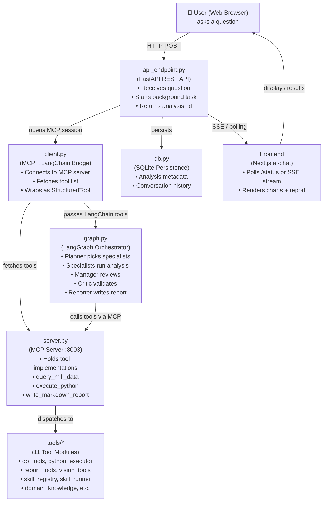
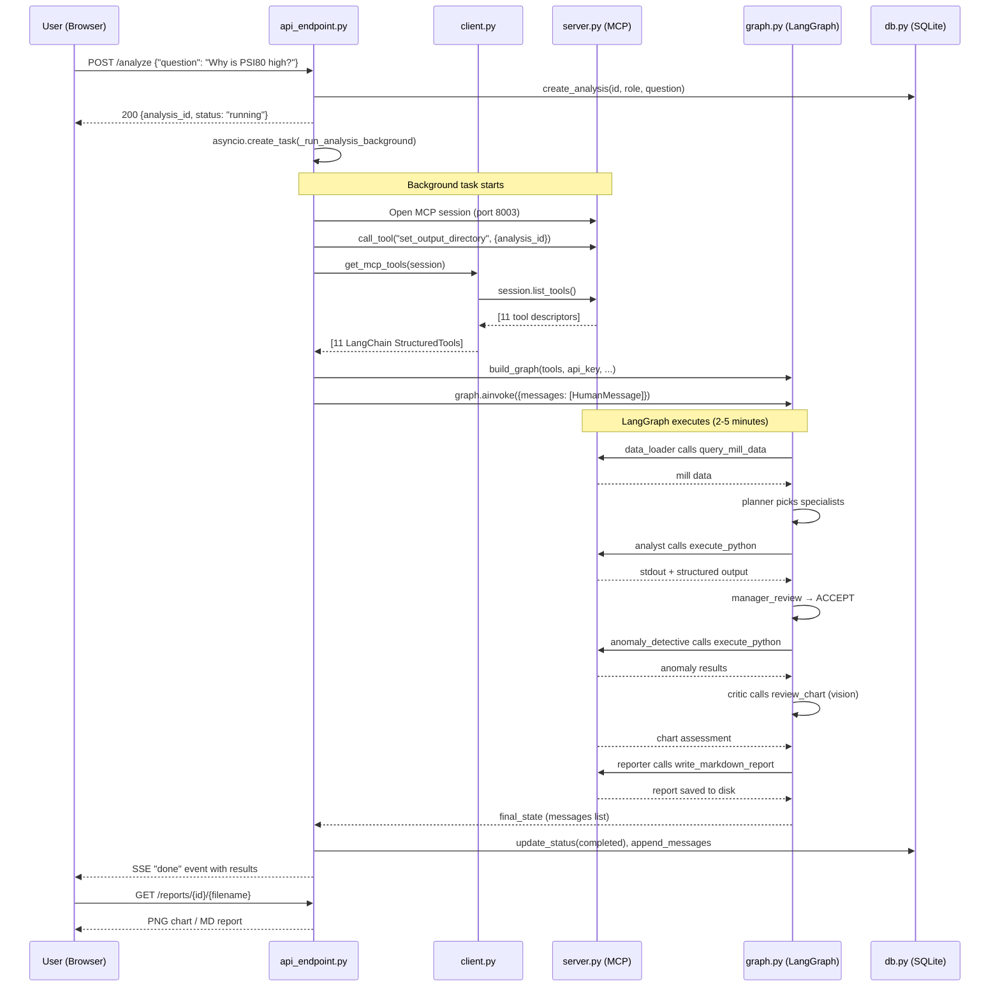
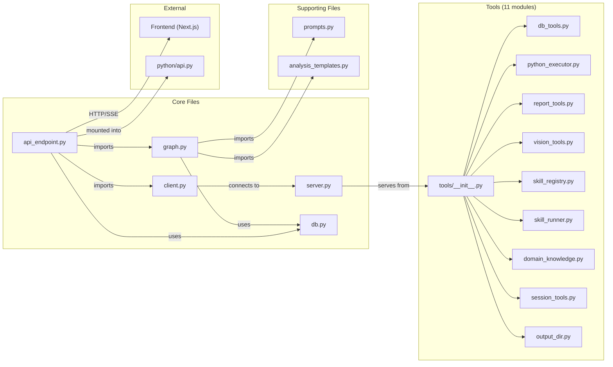

# Agentic Data Analysis System — Overview

## What Is This System?

This is a **multi-agent AI system** for analyzing industrial data from an ore-processing factory with 12 ball mills. A user asks a question in plain language (e.g., "Why did Mill 8 have high PSI80 last week?"), and a team of AI specialists — each with a different expertise — collaborates to load data, run analyses, generate charts, validate results, and write a final report in Bulgarian.

## The Four Layers

Each layer is handled by one of the four core files:

| Layer              | File              | Role                                                      |
| ------------------ | ----------------- | --------------------------------------------------------- |
| REST API           | `api_endpoint.py` | Receives user requests, manages lifecycle, serves results |
| MCP Bridge         | `client.py`       | Converts MCP tools to LangChain format                    |
| MCP Server         | `server.py`       | Hosts the actual tool implementations                     |
| Agent Orchestrator | `graph.py`        | Defines the multi-agent pipeline with LangGraph           |

## Architecture Diagram

## End-to-End Flow

## File Connection Map

## Key Programming Techniques Summary

| Technique                    | File                        | Purpose                                                   |
| ---------------------------- | --------------------------- | --------------------------------------------------------- |
| Closures                     | `client.py`                 | Per-tool call functions that capture MCP session          |
| Dynamic Pydantic models      | `client.py`                 | Build typed schemas at runtime from JSON Schema           |
| Factory pattern              | `graph.py`                  | `make_specialist_node()` creates 6 customized nodes       |
| Async background tasks       | `api_endpoint.py`           | Run 2-5 min analysis without blocking HTTP                |
| Pub/Sub with asyncio.Queue   | `api_endpoint.py`           | SSE real-time progress to multiple clients                |
| Dual storage                 | `api_endpoint.py` + `db.py` | In-memory dict (speed) + SQLite (durability)              |
| FastAPI dependency injection | `api_endpoint.py`           | Role-based access control                                 |
| Adaptive pipeline            | `graph.py`                  | Critic can extend pipeline with new specialists           |
| Parallel fan-out with `Send` | `graph.py`                  | Specialists run concurrently                              |
| Defensive LLM parsing        | `graph.py`                  | Multiple fallback formats for LLM output                  |
| Heuristic short-circuit      | `graph.py`                  | Skip LLM review when output is clearly good               |
| Token budget management      | `graph.py`                  | `build_focused_context()` curates messages per specialist |
| Lifespan hooks               | `server.py`                 | Server startup/shutdown resource management               |

## Documents in This Series

- [00 — Overview](00_overview.md) (this file)
- [01 — server.py: MCP Tool Provider](01_server.md)
- [02 — client.py: MCP-to-LangChain Bridge](02_client.md)
- [03 — api_endpoint.py: REST API Layer](03_api_endpoint.md)
- [04 — graph.py: Multi-Agent Orchestrator](04_graph.md)
- [05 — db.py & tools/: Persistence and Tool Implementations](05_db_and_tools.md)
