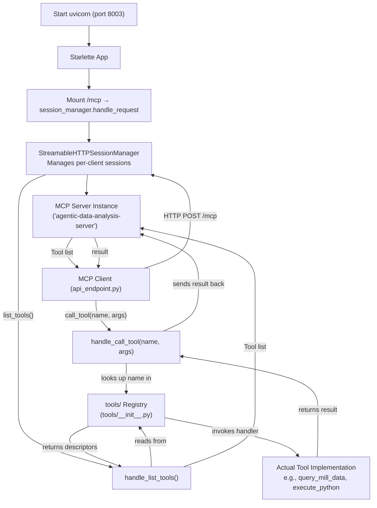
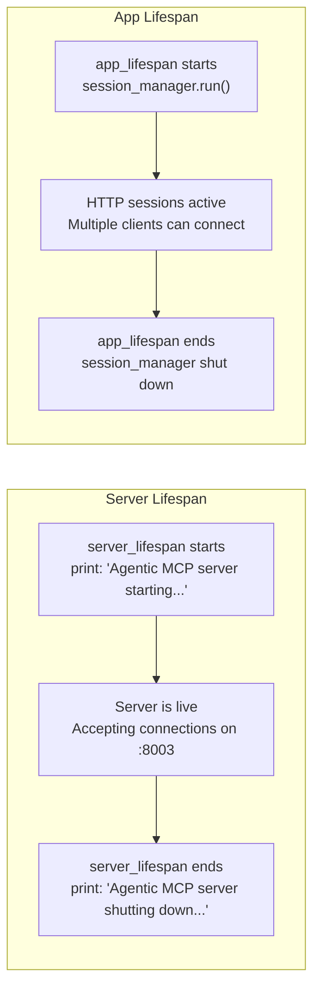
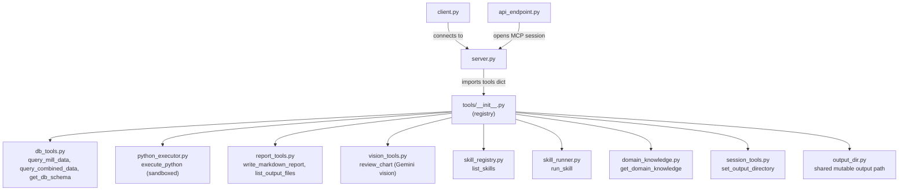

# server.py — The MCP Tool Provider

**File:** `python/agentic/server.py` (89 lines)

## What It Does

`server.py` is an **MCP (Model Context Protocol) server**. Think of MCP as a standardized way for AI agents to call external tools — like a menu in a restaurant. The server is the kitchen: it holds the actual recipes (tool implementations) and cooks the food when an order comes in.

It listens on **port 8003** and exposes 11 tools that AI agents can discover and invoke over HTTP.

## How It Works — Step by Step

### Step 1: Create the MCP Server Instance

```python
server = Server("agentic-data-analysis-server", lifespan=server_lifespan)
```

This creates an MCP `Server` with a name and a **lifespan hook**.

### Step 2: Register Two Handlers

```python
@server.list_tools()
async def handle_list_tools() -> list[types.Tool]:
    return [entry["tool"] for entry in tools.values()]

@server.call_tool()
async def handle_call_tool(name: str, arguments: dict) -> list[types.TextContent]:
    handler = tools[name]["handler"]
    return await handler(arguments)
```

- **`list_tools`** — when a client asks "what tools do you have?", return the list of tool descriptors
- **`call_tool`** — when a client says "run tool X with arguments Y", look up the handler and execute it

The tools themselves are imported from `tools/__init__.py`, which is a **registry** — a dictionary mapping tool names to their descriptor and handler function.

### Step 3: Wrap in HTTP Transport

```python
session_manager = StreamableHTTPSessionManager(server)
```

This wraps the server in a session manager that handles HTTP connections. Multiple clients can connect simultaneously, each getting its own session.

### Step 4: Mount on Starlette

```python
app = Starlette(
    routes=[Mount("/mcp", app=session_manager.handle_request)],
    lifespan=app_lifespan,
)
```

The server is mounted at the path `/mcp`, so the full URL is `http://localhost:8003/mcp`.

### Step 5: Run with Uvicorn

```python
uvicorn.run(app, host="0.0.0.0", port=8003)
```

## Server Operation Flowchart



## Lifespan Management



**The technique — `@asynccontextmanager`:** Both lifespan functions use the `@asynccontextmanager` decorator. This turns a generator function with a single `yield` into an async context manager. Everything before `yield` runs at startup; everything after runs at shutdown. This ensures proper resource allocation and deallocation.

## The Tool Registry

The tools are defined in `tools/__init__.py`:

```python
tools = {
    "get_db_schema":           {"tool": get_db_schema_tool,           "handler": get_db_schema},
    "query_mill_data":         {"tool": query_mill_data_tool,          "handler": query_mill_data},
    "query_combined_data":     {"tool": query_combined_data_tool,      "handler": query_combined_data},
    "execute_python":          {"tool": execute_python_tool,           "handler": execute_python},
    "list_output_files":       {"tool": list_output_files_tool,        "handler": list_output_files},
    "write_markdown_report":   {"tool": write_markdown_report_tool,    "handler": write_markdown_report},
    "set_output_directory":    {"tool": set_output_directory_tool,     "handler": set_output_directory},
    "get_domain_knowledge":    {"tool": get_domain_knowledge_tool,     "handler": get_domain_knowledge},
    "list_skills":             {"tool": list_skills_tool,              "handler": list_skills},
    "run_skill":               {"tool": run_skill_tool,                "handler": run_skill},
    "review_chart":            {"tool": review_chart_tool,             "handler": review_chart},
}
```

Each entry has:

- **`tool`** — an MCP `types.Tool` descriptor (name, description, input JSON Schema)
- **`handler`** — an async function that implements the actual logic

To add a new tool: create its descriptor + handler in the appropriate file, then add one entry here. `server.py` and `client.py` need zero changes.

## Connections to Other Files



## Key Takeaways

- `server.py` is a **thin dispatcher** — it doesn't contain tool logic, just routes requests to handlers
- The **registry pattern** in `tools/__init__.py` makes the system extensible without touching server code
- **Lifespan hooks** ensure clean startup/shutdown
- **StreamableHTTPSessionManager** provides per-client session isolation over HTTP
- The server is the **single source of truth** for tool execution — all agents go through it
