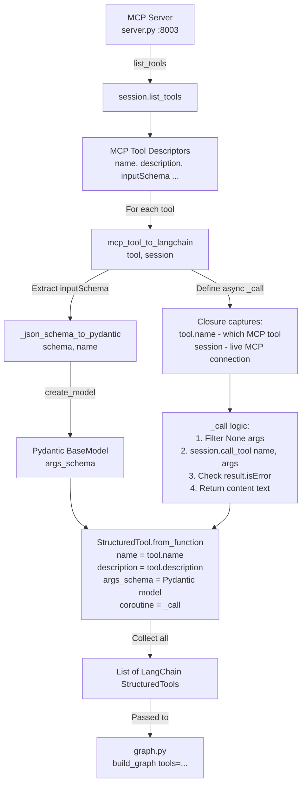
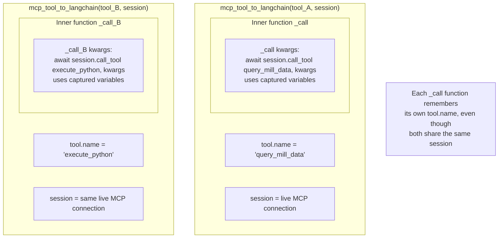
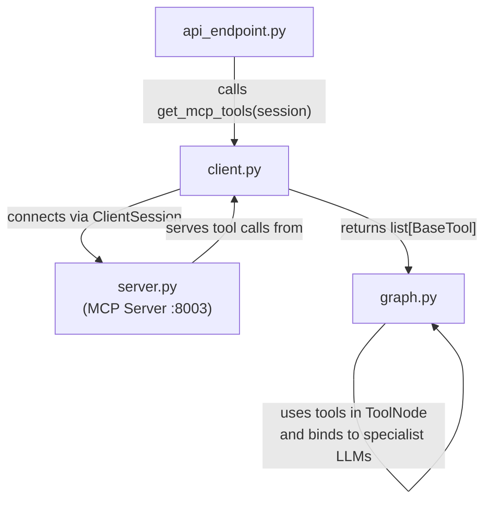

# client.py — The MCP-to-LangChain Bridge

**File:** `python/agentic/client.py` (93 lines)

## What It Does

`client.py` is a **translator**. The MCP server speaks "MCP protocol" (JSON Schema for tool arguments). LangGraph speaks "LangChain" (Pydantic models for tool arguments). `client.py` converts from one to the other so LangGraph's agents can call MCP tools seamlessly.

Think of it as a universal adapter: you have many specialized machines (MCP tools) with different interfaces, and `client.py` makes them all speak the same language (LangChain's `StructuredTool` format).

## The Three Functions

### 1. `_json_schema_to_pydantic()` — Schema Converter

```python
def _json_schema_to_pydantic(schema: dict, model_name: str) -> Type[BaseModel]:
    properties = schema.get("properties", {})
    required = set(schema.get("required", []))
    field_definitions = {}
    for prop_name, prop_meta in properties.items():
        json_type = prop_meta.get("type", "string")
        python_type = {"integer": int, "number": float, "boolean": bool}.get(json_type, str)
        if prop_name in required:
            field_definitions[prop_name] = (python_type, ...)
        else:
            field_definitions[prop_name] = (Optional[python_type], None)
    return create_model(model_name, **field_definitions)
```

**What it does:** MCP tools describe their arguments using JSON Schema. For example, `execute_python` might say it needs `{"code": {"type": "string"}, "timeout": {"type": "integer"}}`. But LangGraph needs a **Pydantic model** — a Python class with typed fields. This function converts one to the other.

**The technique — `pydantic.create_model()`:** This is a dynamic class factory. Instead of writing:

```python
class ExecutePythonArgs(BaseModel):
    code: str
    timeout: Optional[int] = None
```

...you call:

```python
create_model("ExecutePythonArgs", code=(str, ...), timeout=(Optional[int], None))
```

The `...` (Ellipsis) means "required field," and `None` means "optional with default None." This is powerful because the tool schemas are only known at runtime — we can't pre-write classes for tools that might be added later.

### 2. `mcp_tool_to_langchain()` — Tool Wrapper

```python
def mcp_tool_to_langchain(tool: mcp_types.Tool, session: ClientSession) -> BaseTool:
    args_schema = _json_schema_to_pydantic(tool.inputSchema, model_name=tool.name)

    async def _call(**kwargs):
        clean_kwargs = {k: v for k, v in kwargs.items() if v is not None}
        result = await session.call_tool(name=tool.name, arguments=clean_kwargs)
        if result.isError:
            error_text = result.content[0].text if result.content else "Unknown error"
            return f"Error: {error_text}"
        return result.content[0].text

    return StructuredTool.from_function(
        coroutine=_call, name=tool.name, description=tool.description, args_schema=args_schema,
    )
```

**What it does:** Takes a single MCP tool and wraps it in a LangChain `StructuredTool`. The key is the **closure** `_call`.

**The technique — Closures:** A closure is a function that "remembers" variables from the scope where it was created. Here, `_call` captures `tool.name` and `session`. Even though `_call` is returned and will be called much later from inside a LangGraph node, it still has access to those variables. This means each tool's call function knows which MCP tool to invoke and which session to use, without needing those passed as arguments.

**The technique — `StructuredTool.from_function()`:** LangChain's `StructuredTool` is a wrapper that gives a plain function superpowers: it can be discovered by name, its arguments are validated against the Pydantic schema, and it can be invoked both synchronously and asynchronously. By passing `coroutine=_call`, we register it as an async function.

**Filtering None values:** `clean_kwargs = {k: v for k, v in kwargs.items() if v is not None}` — this removes optional parameters the user didn't set. MCP servers can be picky about receiving `null` for optional fields, so we strip them.

### 3. `get_mcp_tools()` — Session Factory

```python
async def get_mcp_tools(session: ClientSession) -> list[BaseTool]:
    tools_result = await session.list_tools()
    langchain_tools = [mcp_tool_to_langchain(t, session) for t in tools_result.tools]
    return langchain_tools
```

**What it does:** Called once after the MCP session is opened. It asks the server "what tools do you have?" and wraps each one as a LangChain tool. The returned list is passed directly to `graph.py`'s `build_graph()` function.

## Conversion Flowchart



## Closure Mechanism Explained



## Connections to Other Files



## Key Takeaways

- `client.py` is a **pure adapter** — it contains no business logic, only conversion code
- **Closures** allow each tool to "remember" its MCP identity without repetitive code
- **Dynamic Pydantic models** handle the fact that tool schemas are only known at runtime
- The conversion happens **once per analysis** — tools are fetched and wrapped at the start, then reused throughout the entire LangGraph execution
- **Error handling** is built into the closure — MCP errors are caught and returned as text strings (which the LLM can read and react to)
