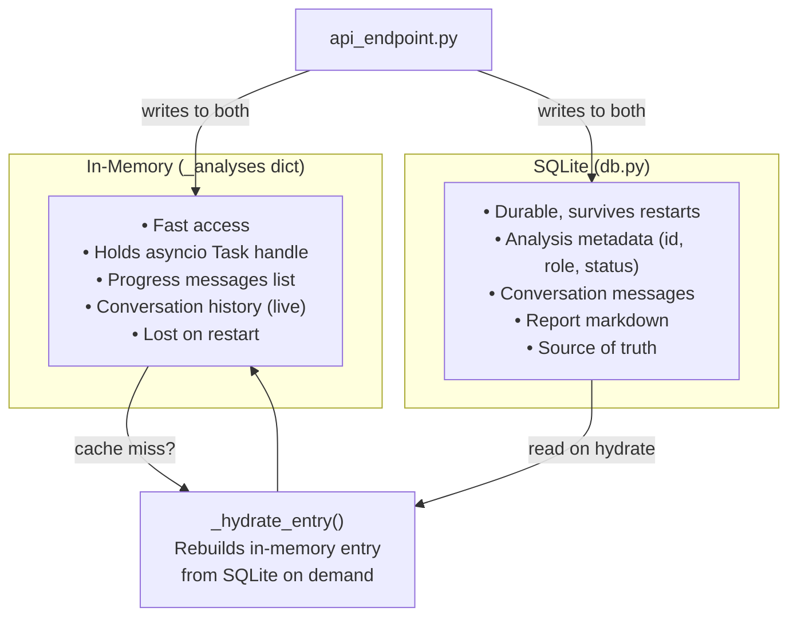
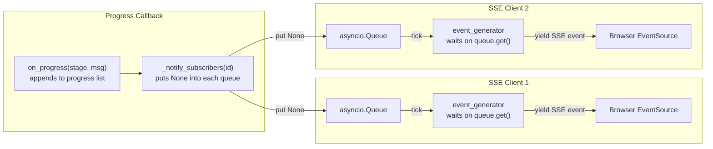
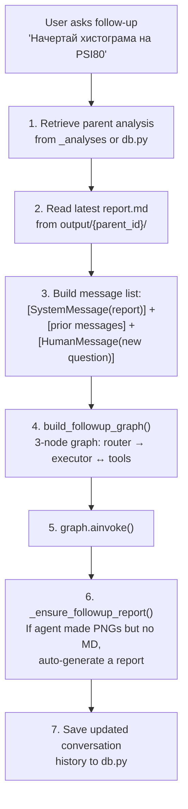
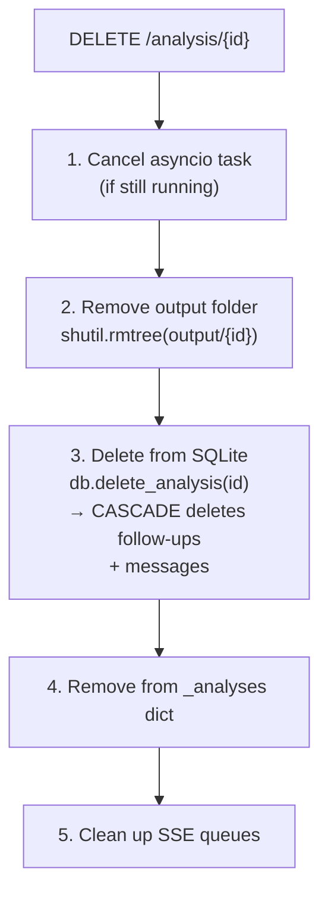
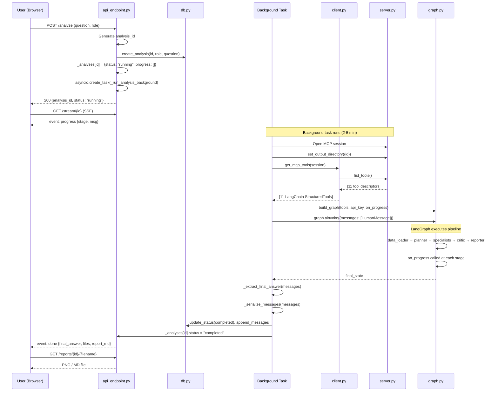
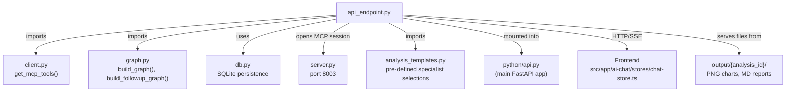

# api_endpoint.py — The REST API Layer

**File:** `python/agentic/api_endpoint.py` (1351 lines)

## What It Does

This is the **bridge between the web frontend and the AI engine**. It exposes REST endpoints that the Next.js frontend calls. When a user submits a question, this file:

1. Generates a unique `analysis_id`
2. Saves the request to SQLite (via `db.py`)
3. Launches the multi-agent pipeline in the **background** (so the HTTP response returns immediately)
4. Lets the frontend **poll** or **stream** progress updates
5. Serves generated files (PNG charts, MD reports)

## API Endpoints

| Method | Path                           | Purpose                       |
| ------ | ------------------------------ | ----------------------------- |
| POST   | `/analyze`                     | Start a new analysis          |
| POST   | `/followup/{id}`               | Ask a follow-up question      |
| GET    | `/status/{id}`                 | Poll for status (fallback)    |
| GET    | `/stream/{id}`                 | SSE stream of progress events |
| GET    | `/reports`                     | List all generated files      |
| GET    | `/reports/{id}/{filename}`     | Download a specific file      |
| GET    | `/conversations`               | List past analyses by role    |
| GET    | `/conversations/{id}/messages` | Get message history           |
| DELETE | `/analysis/{id}`               | Delete an analysis + files    |
| DELETE | `/followup/{id}`               | Delete a single follow-up     |
| POST   | `/cancel/{id}`                 | Cancel a running analysis     |
| GET    | `/templates`                   | List analysis templates       |

## Key Programming Techniques

### 1. Role-Based Access Control with FastAPI Dependencies

```python
ALLOWED_ROLES = {"mechanic", "technologist", "manager"}

def require_role(
    x_user_role: Optional[str] = Header(None, alias="X-User-Role"),
    role: Optional[str] = None,
) -> str:
    raw = (x_user_role or role or "").strip().lower()
    if not raw:
        raise HTTPException(status_code=400, detail="Missing role")
    if raw not in ALLOWED_ROLES:
        raise HTTPException(status_code=400, detail=f"Invalid role '{raw}'")
    return raw
```

**The technique — FastAPI Dependencies (`Depends`):** FastAPI has a dependency injection system. When you write `role: str = Depends(require_role)`, FastAPI automatically calls `require_role` before your endpoint runs. If it raises an `HTTPException`, the endpoint never runs. This is a clean way to enforce authentication without repeating the check in every endpoint.

**The dual-source pattern:** The role can come from either the `X-User-Role` header (set by the frontend's JavaScript `fetch` calls) OR a `?role=mechanic` query parameter (used by native HTML elements like `` which can't set custom headers). This is a practical workaround for browser limitations.

### 2. Background Tasks with `asyncio.create_task`

```python
task = asyncio.create_task(_run_analysis_background(
    analysis_id, full_prompt, settings=settings, ...
))
_analyses[analysis_id]["task"] = task
```

**The technique — Fire-and-forget async tasks:** `asyncio.create_task()` schedules a coroutine to run concurrently without blocking the current function. The POST `/analyze` endpoint returns immediately with a response (analysis_id + "running"), while the actual AI pipeline runs in the background. The task handle is stored so it can be **cancelled** later if the user clicks "Cancel."

**Why not FastAPI's `BackgroundTasks`?** FastAPI's built-in `BackgroundTasks` runs after the response is sent but doesn't give you a handle to cancel. By using `asyncio.create_task` directly, we get a `Task` object we can `.cancel()`.

### 3. Dual Storage — In-Memory + SQLite



The system keeps two copies of state:

- **In-memory dict (`_analyses`)** — fast, holds the asyncio task handle, progress messages, conversation history. Lost on restart.
- **SQLite (`analyses.db` via `db.py`)** — durable, survives restarts. Used for conversation listing across browsers.

The `_hydrate_entry()` function bridges the gap: if someone asks for an analysis that's in SQLite but not in `_analyses` (because the server restarted), it rebuilds the in-memory entry from the database.

### 4. Server-Sent Events (SSE) for Real-Time Progress

```python
@router.get("/stream/{analysis_id}")
async def stream_analysis(analysis_id, request, role):
    async def event_generator():
        queue = asyncio.Queue(maxsize=256)
        _event_queues.setdefault(analysis_id, []).append(queue)
        sent = 0
        while True:
            while sent < len(progress):
                yield _sse("progress", progress[sent])
                sent += 1
            if status != "running":
                yield _sse("done", result.model_dump())
                break
            await asyncio.wait_for(queue.get(), timeout=15.0)
    return StreamingResponse(event_generator(), media_type="text/event-stream")
```

**The technique — SSE with asyncio.Queue (pub/sub):**



Multiple SSE clients each get their own `asyncio.Queue`. When a specialist finishes, the progress callback calls `_notify_subscribers()` which puts `None` into every queue (a "tick"). The generator wakes up, flushes new progress messages, and goes back to waiting. The 15-second heartbeat prevents proxies (like nginx) from closing idle connections.

**Why SSE instead of polling?** The frontend opens one `EventSource` connection and receives progress events as they happen — no need to poll every 4 seconds. The polling endpoint (`/status/{id}`) remains as a fallback.

### 5. The Background Analysis Runner

This is the **heart of the integration** between all four core files:

```python
async def _run_analysis_background(analysis_id, prompt, settings, template_id, role):
    async with streamable_http_client(SERVER_URL) as (read, write, _):
        async with ClientSession(read, write) as session:
            await session.initialize()
            await session.call_tool("set_output_directory", {"analysis_id": analysis_id})
            langchain_tools = await get_mcp_tools(session)
            graph = build_graph(langchain_tools, api_key, on_progress=on_progress, ...)
            final_state = await graph.ainvoke(
                {"messages": [HumanMessage(content=prompt)]},
                config={"configurable": {"thread_id": analysis_id}, "recursion_limit": 150},
            )
```

**The technique — `async with` context managers:** The `streamable_http_client` and `ClientSession` are both async context managers. They handle connection setup and teardown automatically. If an exception occurs, the connection is still properly closed.

**The technique — `recursion_limit: 150`:** LangGraph counts each node transition as a "recursion" step. With 150, the graph can traverse up to 150 nodes before stopping. This prevents infinite loops if a specialist keeps requesting rework.

### 6. Follow-Up Conversations

The follow-up system is remarkably sophisticated:



**Key details:**

- **`_rebuild_messages`** — converts the serialized message history from the DB back into LangChain `BaseMessage` objects
- **`_read_latest_report_markdown`** — fetches the most recent Markdown report from the analysis's output folder. This report is injected as a `SystemMessage` so the follow-up agent has the full factual context
- **`_ensure_followup_report`** — guarantees that every follow-up produces a Markdown artifact. If agents generate new charts but no new Markdown, this function synthesizes a report embedding those charts and the agent's textual answer

### 7. Coordinated Cleanup on Delete



Deleting a follow-up is even more complex — it requires trimming the parent's message history in the DB to remove the deleted exchange, ensuring it doesn't reappear in future contexts.

## Analysis Request Lifecycle



## Per-Analysis Output Subfolders

Each analysis writes to `output/{analysis_id}/` instead of a shared flat directory:

- **Isolates files** between analyses (no naming conflicts)
- **Enables cleanup** when conversations are deleted (`shutil.rmtree`)
- The MCP server has a shared mutable `output_dir` state via `tools/output_dir.py`
- `set_output_directory` MCP tool configures the subfolder before each analysis run
- `api_endpoint.py` calls `session.call_tool("set_output_directory", {"analysis_id": ...})` before invoking the graph

## Connections to Other Files



## Key Takeaways

- `api_endpoint.py` is the **public face** of the agentic system — all frontend interaction goes through it
- **Background tasks** prevent long AI analysis from blocking HTTP responses
- **SSE** provides real-time progress updates without polling
- **Dual storage** (in-memory + SQLite) balances speed and durability
- **Follow-up conversations** inject the previous report as context, ensuring continuity
- **Role-based access control** ensures users only see their own analyses
- **Per-analysis output folders** isolate files and enable clean deletion
- The file is the **orchestrator** — it doesn't do AI work itself, it coordinates between `client.py`, `graph.py`, `server.py`, and `db.py`
