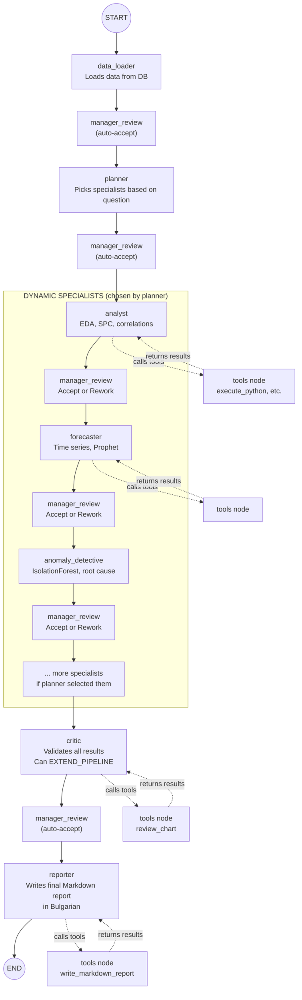
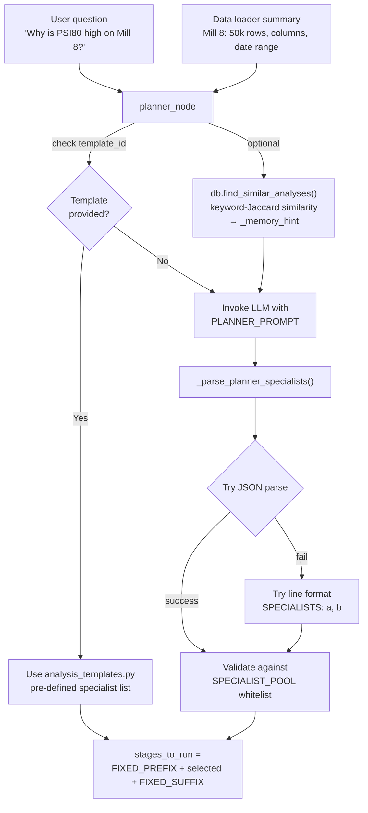
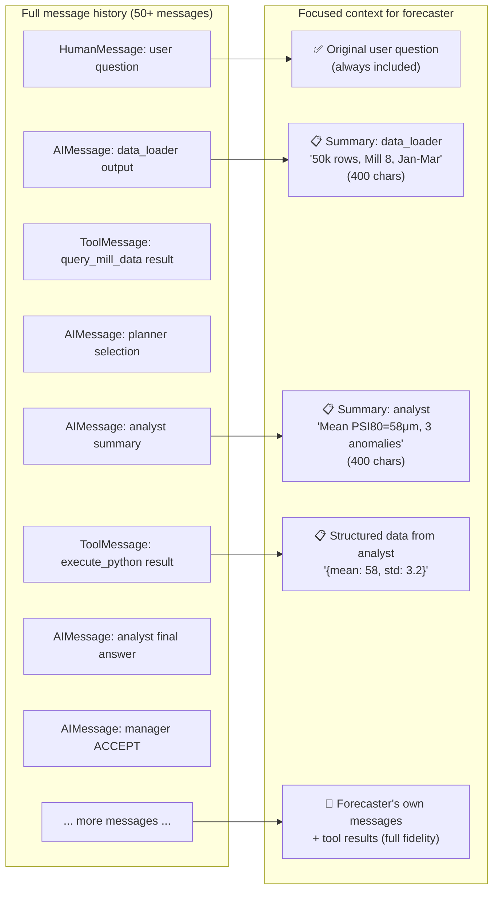
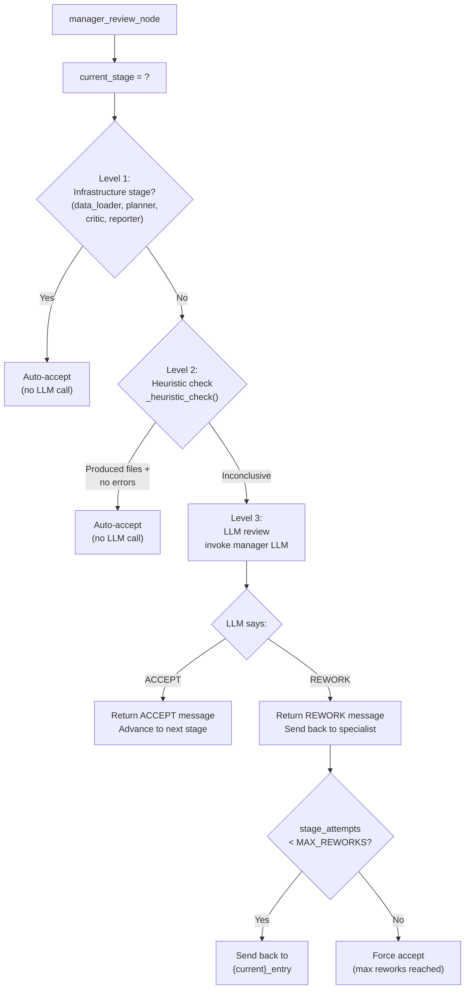
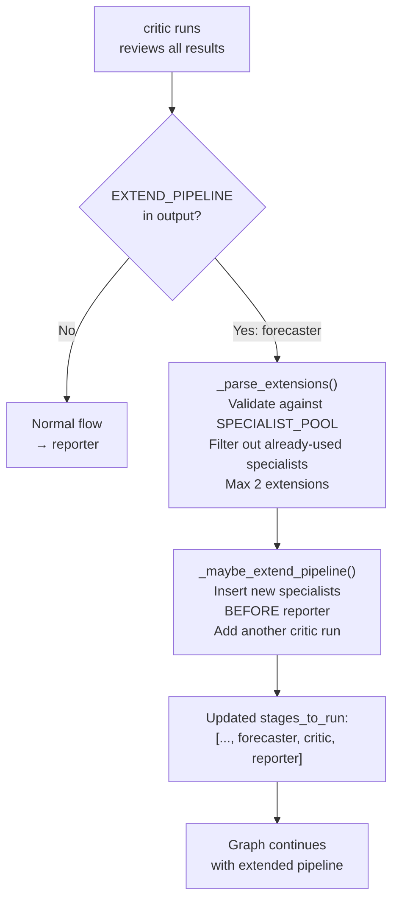
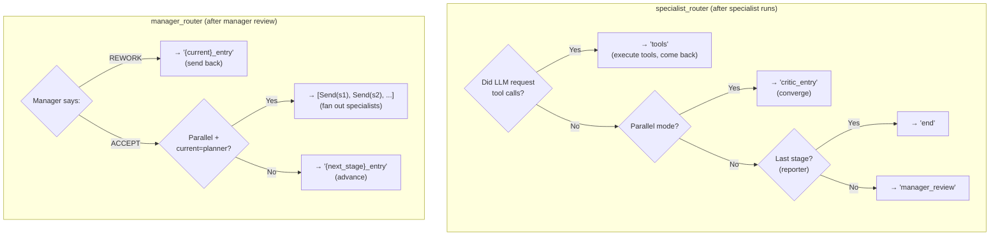
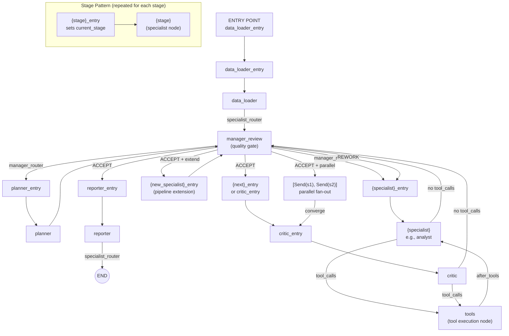
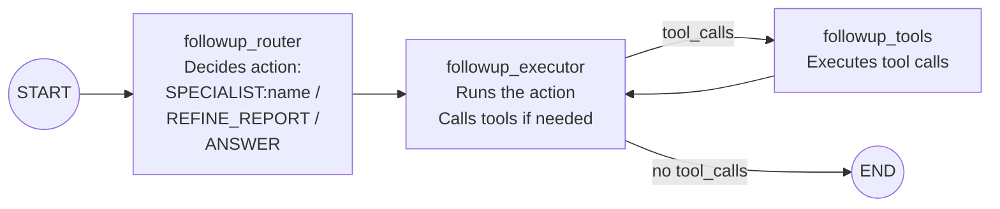
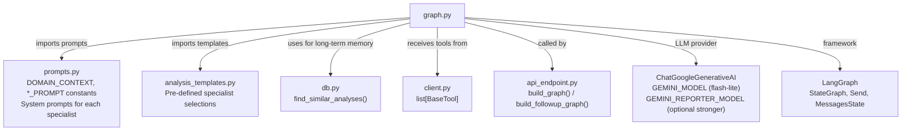

# graph.py — The Multi-Agent Orchestrator

**File:** `python/agentic/graph.py` (1239 lines)

## What It Does

This is the most complex file. It builds a **LangGraph state machine** that orchestrates a team of AI specialists. Think of it as the blueprint for how your team of AI experts will collaborate, what their roles are, and how they pass information between each other to solve a complex problem.

## The Architecture



## The State Object

```python
class AnalysisState(MessagesState):
    current_stage: str
    stages_to_run: list[str]
    stage_attempts: dict
    parallel_mode: bool
    extensions_used: int
```

**The technique — `MessagesState`:** LangGraph's `MessagesState` is a pre-built state class that contains a `messages` list. It has a special **reducer**: when a node returns `{"messages": [new_msg]}`, the new message is **appended** to the existing list rather than replacing it. This is crucial — each specialist adds its output to a growing conversation thread.

The custom fields (`current_stage`, `stages_to_run`, etc.) use standard dict-merge semantics: returning `{"stages_to_run": [...]}` replaces the old list.

## The Specialist Pool

```python
SPECIALIST_POOL = [
    "analyst", "forecaster", "anomaly_detective",
    "bayesian_analyst", "optimizer", "shift_reporter",
]
FIXED_PREFIX = ["data_loader", "planner"]
FIXED_SUFFIX = ["critic", "reporter"]
```

The pipeline always starts with `data_loader` and `planner`, always ends with `critic` and `reporter`, but the middle is **dynamic** — the planner decides which specialists to include based on the user's question.

## Key Components Explained

### 1. The Planner Node

```python
def planner_node(state: AnalysisState) -> dict:
    # Invoke LLM with PLANNER_PROMPT + user question + data summary
    selected = _parse_planner_specialists(content)
    stages = FIXED_PREFIX + selected + FIXED_SUFFIX
    return {
        "messages": [AIMessage(content=content, name="planner")],
        "stages_to_run": stages,
        "current_stage": "planner",
    }
```

The planner is the "brain" of the system. It reads the user's question and the data summary, then decides: "This question about forecasting needs the forecaster and the analyst." It returns a list like `["data_loader", "planner", "analyst", "forecaster", "critic", "reporter"]`.

**The technique — Defensive LLM parsing (`_parse_planner_specialists`):** LLMs are unpredictable. Sometimes they return clean JSON `{"specialists": ["analyst", "forecaster"]}`, sometimes they write `SPECIALISTS: analyst, forecaster` in plain text. This function tries JSON first (with regex to extract `{...}` from surrounding prose), then falls back to the legacy line format. Always assume the LLM might not follow instructions perfectly.

**The technique — Template override:** If a `template_id` is provided (from `api_endpoint.py`), the planner skips the LLM call and directly uses a pre-defined list of specialists from `analysis_templates.py`. This allows for faster, more predictable execution for common analysis types.

**The technique — Long-term memory (`_memory_hint`):** The planner can be given a "hint" about similar past analyses (retrieved from `db.py` using keyword-Jaccard similarity). This helps the planner make better decisions about which specialists are typically useful for a given type of query, without needing complex embedding models.



### 2. The Specialist Node Factory

```python
def make_specialist_node(name: str):
    system_prompt = ALL_PROMPTS[name]
    stage_llm = specialist_llms[name]

    def specialist_node(state: AnalysisState) -> dict:
        iteration = sum(1 for m in state["messages"] if getattr(m, "name", None) == name) + 1
        if iteration > _MAX_SPECIALIST_ITERS:
            return {"messages": [AIMessage(content=f"[{name}] Done (cap).", name=name)]}

        focused = build_focused_context(raw_msgs, name)
        messages = [SystemMessage(content=system_prompt)] + focused
        response = stage_llm.invoke(messages)
        response.name = name
        return {"messages": [response]}

    return specialist_node
```

**The technique — Factory pattern with closures:** `make_specialist_node` is a function that **returns a function**. Each returned `specialist_node` is customized for a specific specialist (analyst, forecaster, etc.) via closure variables. This avoids writing 6 nearly-identical functions.

**The technique — Iteration counting:** The line `iteration = sum(1 for m in state["messages"] if getattr(m, "name", None) == name) + 1` counts how many times this specialist has already spoken in the conversation. If it exceeds `_MAX_SPECIALIST_ITERS` (default 5), the specialist is forced to stop. This prevents infinite tool-calling loops.

**The technique — Tool binding (`base_llm.bind_tools(stage_tools)`):** For each specialist, a specific subset of the available tools is bound to its LLM. For example, a `data_loader` needs data querying tools, while a `reporter` needs report writing tools. This reduces the LLM's context window, improves performance, and prevents agents from attempting to use irrelevant tools.

**The technique — Model tiering:** `GEMINI_MODEL` is used for most specialists (cheaper, faster), while `GEMINI_REPORTER_MODEL` can be configured to use a more powerful model for the `reporter` stage, where high-quality, nuanced output is critical. This is a cost-optimization and quality-control strategy.

### 3. Focused Context Building

```python
def build_focused_context(all_msgs: list[BaseMessage], stage_name: str) -> list[BaseMessage]:
    # 1. Extract the original user question
    # 2. Build a compact summary of prior stages' results
    # 3. Include this specialist's own previous messages + tool results
    # 4. Compress everything to fit token budget
```

**Why this matters:** By the time the 3rd specialist runs, there might be 50+ messages in the state. Sending all of them to the LLM would be expensive and confusing. `build_focused_context` creates a **curated view**.



**The technique — `STRUCTURED_OUTPUT` extraction:** When skills emit `STRUCTURED_OUTPUT:{json}` lines, these are extracted and passed forward as `[structured data]: {...}` in the summary. This creates a **structured data channel** that flows between specialists without polluting the prose.

### 4. Message Compression Helpers

| Function                    | Purpose                                                                                                                |
| --------------------------- | ---------------------------------------------------------------------------------------------------------------------- |
| `truncate(text, max_chars)` | Shortens long text (e.g., tool outputs) to fit within the window                                                       |
| `compress_messages(msgs)`   | Keeps only the most recent messages, truncates older ones to stay within `_MAX_MESSAGES_WINDOW` (14)                   |
| `strip_tool_messages(msgs)` | Removes verbose `ToolMessage` objects and `AIMessage`s that only contain `tool_calls` before passing history to an LLM |
| `normalize_content(raw)`    | Flattens Gemini's list-of-dicts content format into a plain string                                                     |

**The technique — Context window management:** LLMs have a limited "context window" (the amount of text they can process at once). These functions are critical for keeping the conversation history clean, focused, and within token limits.

### 5. The Manager Review Node

```python
def manager_review_node(state: AnalysisState) -> dict:
    current = state.get("current_stage", "data_loader")

    # Level 1: Auto-accept infrastructure stages
    if current in _AUTO_ACCEPT_STAGES:
        return {"messages": [AIMessage(content=f"ACCEPT: {current} completed.", name="manager")]}

    # Level 2: Heuristic auto-accept
    heuristic_reason = _heuristic_check(state["messages"], current)
    if heuristic_reason:
        return {"messages": [AIMessage(content=f"ACCEPT: {heuristic_reason}", name="manager")]}

    # Level 3: LLM review
    response = llm.invoke(messages)
    if "REWORK" in content.upper():
        return {"messages": [AIMessage(content=f"REWORK: {content}", name="manager")]}
    return {"messages": [AIMessage(content=f"ACCEPT: {content}", name="manager")]}
```

The manager is a **quality gate** between every specialist. It has three levels of strictness:



**The technique — Heuristic auto-accept (`_heuristic_check`):** For certain conditions (e.g., if a specialist produced new files, structured output, and no errors), the manager can _automatically_ accept the output without needing an LLM call. This speeds up the process when things are going well.

### 6. The Critic and Adaptive Pipeline Extension

```python
def _maybe_extend_pipeline(state: AnalysisState) -> dict | None:
    extras = _parse_extensions(state["messages"], stages)
    if extras:
        new_stages = stages[:reporter_idx] + extras + ["critic"] + stages[reporter_idx:]
        return {"stages_to_run": new_stages, "extensions_used": ext_used + 1}
```

**The technique — Adaptive pipeline:** The critic can look at all the results and say "we need more analysis — bring in the forecaster." This is done by emitting `EXTEND_PIPELINE: forecaster` in its output. The manager splices the new specialist into `stages_to_run` before the reporter, and the critic runs again afterward. Up to 2 extensions are allowed (`_MAX_PIPELINE_EXTENSIONS = 2`).



This makes the pipeline **self-modifying** — it can grow based on what the analysis reveals.

### 7. The Tool Node

```python
async def tool_node(state: AnalysisState) -> dict:
    last_message = state["messages"][-1]
    owner_name = getattr(last_message, "name", None) or "specialist"
    results = []
    for tc in last_message.tool_calls:
        tool = tools_by_name.get(tc["name"])
        output = await tool.ainvoke(tc["args"])
        results.append(ToolMessage(content=str(output), tool_call_id=tc["id"], name=tc["name"]))
        if tc["name"] == "execute_python":
            _stream_structured_outputs(owner_name, output_str)
    return {"messages": results}
```

When a specialist's LLM response includes `tool_calls`, the graph routes to `tool_node`. This node executes each requested tool (via the LangChain tools created by `client.py`), wraps the result in a `ToolMessage`, and returns it. The graph then routes back to the same specialist so it can read the tool output and continue.

**The technique — `_stream_structured_outputs()`:** After `execute_python` runs, the tool node scans its stdout for `STRUCTURED_OUTPUT:{json}` lines and forwards them as progress events. This is how live "data tiles" appear in the UI while the analysis is running.

### 8. Routing Logic



**The technique — `Send` for parallel fan-out:** When parallel mode is enabled, the manager returns a **list of `Send` objects** instead of a string. Each `Send` dispatches a copy of the state to a different specialist node simultaneously. LangGraph runs them concurrently, and they all converge at the critic.

### 9. Graph Assembly

```python
graph = StateGraph(AnalysisState)

# Register nodes
for stage in ALL_STAGES:
    graph.add_node(f"{stage}_entry", make_stage_entry(stage))
    graph.add_node(stage, make_specialist_node(stage))

graph.add_node("planner", planner_node)
graph.add_node("tools", tool_node)
graph.add_node("manager_review", manager_review_node)

# Wire edges
graph.set_entry_point("data_loader_entry")
for stage in ALL_STAGES:
    graph.add_edge(f"{stage}_entry", stage)
    graph.add_conditional_edges(stage, specialist_router, {...})
graph.add_conditional_edges("tools", after_tools, {...})
graph.add_conditional_edges("manager_review", manager_router, {...})

return graph.compile(checkpointer=checkpointer)
```

**The technique — Two-node pattern (entry + specialist):** Each stage has two nodes: `{stage}_entry` (sets `current_stage` in state) and `{stage}` (the actual specialist). This separation is needed because the manager router needs a stable target to route to (`analyst_entry`), and the entry node ensures the state knows which stage is active before the specialist runs.

## Full Graph Wiring Diagram



## The Follow-Up Graph

The follow-up graph is much simpler — just 3 nodes:



### Follow-Up Router Logic

The router decides one of three actions:

| Action               | When to use                          | What happens                               |
| -------------------- | ------------------------------------ | ------------------------------------------ |
| `SPECIALIST:analyst` | User asks for new charts/analysis    | Runs a specialist to produce new artifacts |
| `REFINE_REPORT`      | User asks to restructure/expand text | Rewrites existing Markdown report          |
| `ANSWER`             | User asks a trivial textual question | Replies with text only, no new files       |

**The safety net:** If the router says `ANSWER` but the user's question contains chart keywords ("начертай", "графика", "plot", "histogram"), the system overrides to `SPECIALIST:analyst`:

```python
if action.upper() == "ANSWER" and any(k in user_text for k in CHART_KEYWORDS):
    action = "SPECIALIST:analyst"
```

This catches the common failure mode where the LLM ignores its instructions and tries to answer directly.

### Follow-Up State

```python
class FollowUpState(MessagesState):
    action: str        # SPECIALIST:<name>, REFINE_REPORT, or ANSWER
    instruction: str   # What to do
```

Simpler than `AnalysisState` — no dynamic stages, no parallel mode, no extensions.

## Connections to Other Files



## Key Takeaways

- `graph.py` is the **brain** — it defines how AI specialists collaborate
- The **planner** makes the pipeline dynamic — only relevant specialists run
- The **manager review** provides quality control with three strictness levels
- The **critic** can **extend the pipeline** — the system is self-modifying
- **Focused context** and **message compression** keep token usage manageable
- **Parallel fan-out** with `Send` allows concurrent specialist execution
- **Defensive parsing** handles unpredictable LLM outputs
- The **follow-up graph** is a simplified 3-node version for conversational refinement
- **Model tiering** optimizes cost: cheaper model for most tasks, stronger model for reporting
