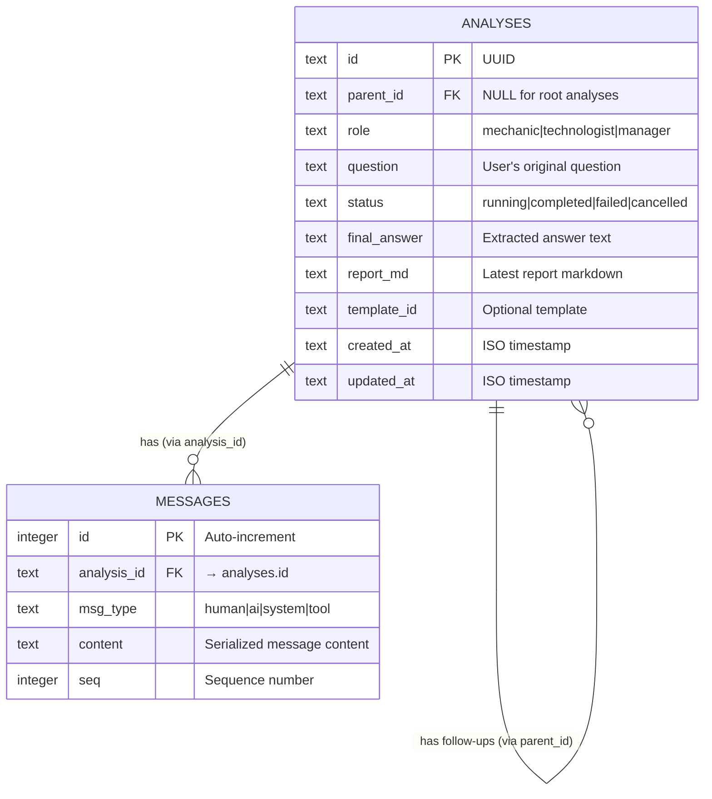
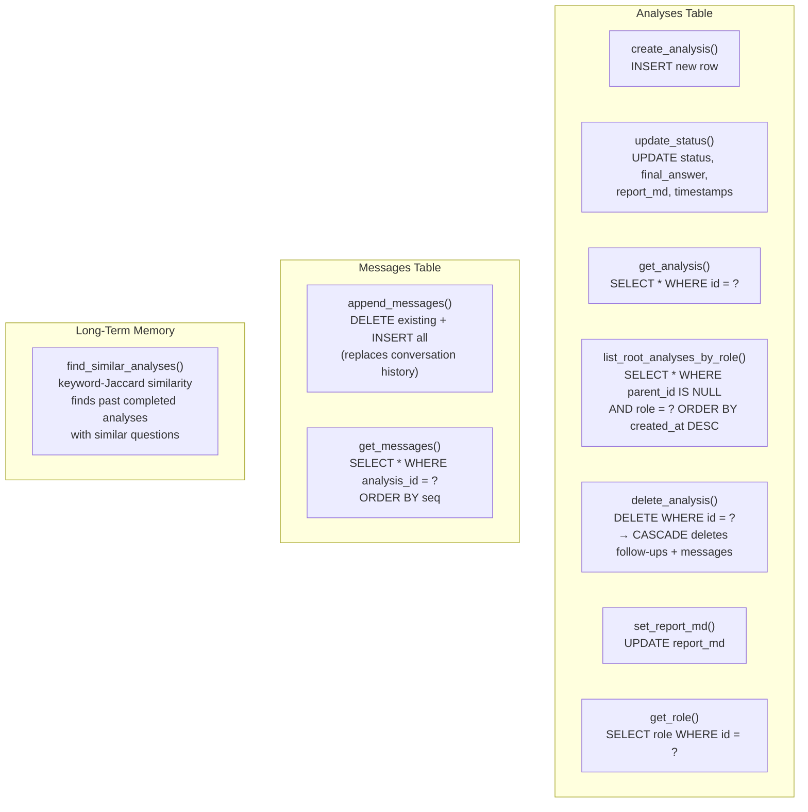
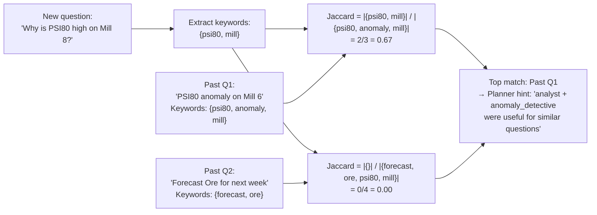
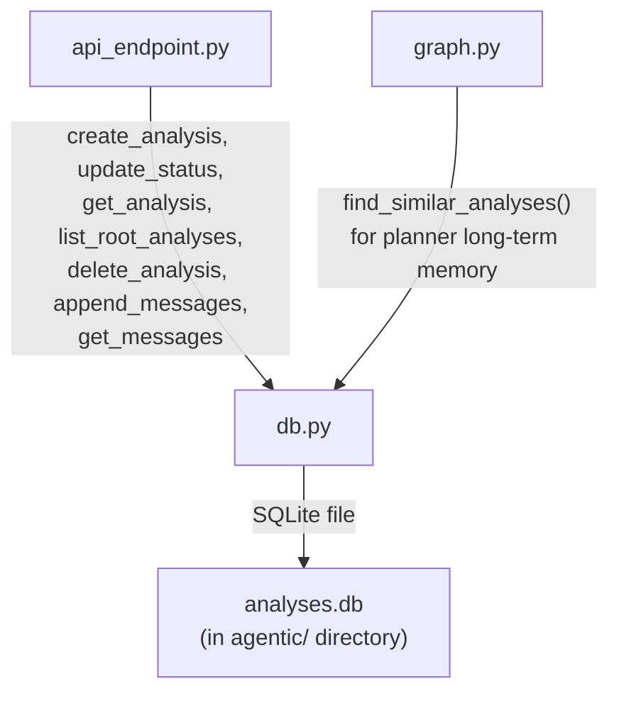
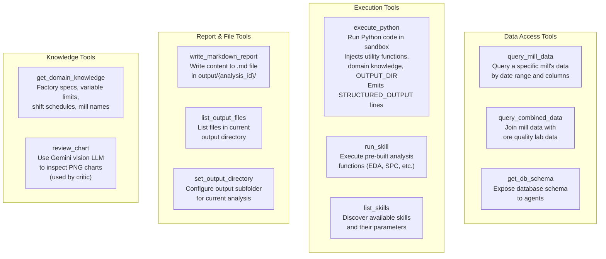
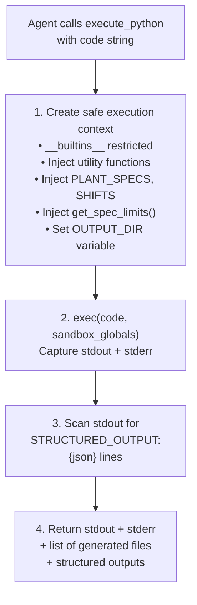
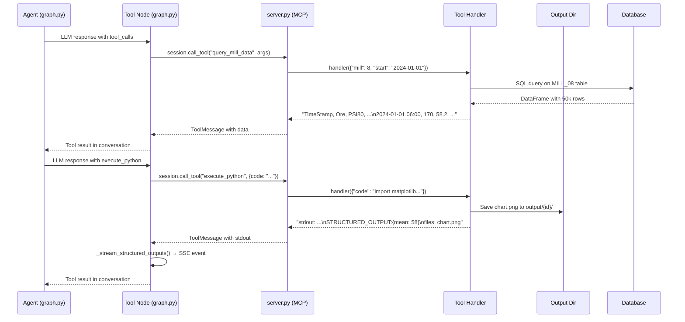

# db.py & tools/ — Persistence and Tool Implementations

## Part 1: `db.py` — The Memory Keeper

**File:** `python/agentic/db.py` (346 lines)

### What It Does

`db.py` handles all interactions with a SQLite database (`analyses.db`). It provides persistence for the agentic system — storing metadata about each analysis run and the detailed conversation messages associated with them. This allows for continuity across server restarts and for follow-up conversations.

### Database Schema



**The technique — Foreign Key with `ON DELETE CASCADE`:** Both the `analyses` table (self-referencing for follow-ups) and the `messages` table have `FOREIGN KEY ... ON DELETE CASCADE`. This means if a parent analysis is deleted, all its follow-ups and all associated messages are automatically deleted by the database. This ensures data integrity and simplifies cleanup — no manual orphan-record cleanup needed.

### Connection Management

```python
_conn: sqlite3.Connection | None = None
_lock = threading.Lock()

def _connect():
    global _conn
    if _conn is None:
        _conn = sqlite3.connect(DB_PATH, check_same_thread=False)
        _conn.row_factory = sqlite3.Row  # dict-like access to rows
        _conn.execute("PRAGMA journal_mode=WAL")  # Write-Ahead Logging
        _conn.execute("PRAGMA foreign_keys=ON")  # Enforce FK constraints
    return _conn
```

**The technique — Thread-Safe Singleton Connection:**

- `_conn` — a global variable holding the single SQLite connection
- `_lock` — a `threading.Lock` protects access. SQLite connections are not thread-safe for concurrent writes. The lock ensures only one thread accesses the connection at a time
- `check_same_thread=False` — allows the connection to be shared across threads (required for FastAPI's async model)
- **WAL (Write-Ahead Logging)** — allows concurrent readers while a write is in progress, improving performance
- `row_factory = sqlite3.Row` — enables dictionary-like access to rows (`row["status"]` instead of `row[2]`)

### Context Manager for Cursors

```python
@contextmanager
def _cursor() -> Iterator[sqlite3.Cursor]:
    conn = _connect()
    with _lock:
        cur = conn.cursor()
        try:
            yield cur
            conn.commit()
        except Exception:
            conn.rollback()
            raise
        finally:
            cur.close()
```

**The technique — `@contextmanager`:** This turns a generator function into a context manager (`with _cursor() as cur:`). It automatically:

1. Acquires the thread lock
2. Creates a cursor
3. Yields it for use
4. Commits on success, rolls back on exception
5. Closes the cursor and releases the lock

All CRUD functions use this pattern, ensuring proper transaction handling.

### CRUD Operations



### Long-Term Memory — `find_similar_analyses()`

```python
_MEMORY_KEYWORDS = (
    "psi80", "psi200", "ore", "water", "power", "density", "pressure",
    "anomaly", "anomalies", "forecast", "predict", "oee", "availability",
    "correlation", "histogram", "spc", "shift", "mill", "energy",
    "downtime", "uptime", "optimization", "setpoint", "target",
)

def find_similar_analyses(question: str, role: str, limit: int = 3) -> list[dict]:
    # Tokenize question on domain keywords
    # For each past completed analysis (same role):
    #   Compute Jaccard similarity = |intersection| / |union|
    # Return top-N by similarity score
```

**The technique — Keyword-Jaccard Similarity:** This is a lightweight "long-term memory" that doesn't require embedding models. It:

1. Tokenizes the user's question on domain-specific keywords (e.g., "psi80", "anomaly", "forecast")
2. For each past completed analysis (same role), tokenizes its question the same way
3. Computes the **Jaccard similarity coefficient**: `|intersection| / |union|` of the two keyword sets
4. Returns the top-N most similar past analyses

This gives the planner hints about which specialists were useful for similar past questions.



### Connection to Other Files



---

## Part 2: `tools/` — Tool Implementations

The `tools/` directory contains 9 modules that implement the 11 tools served by `server.py`. Each module defines:

- A **tool descriptor** (MCP `types.Tool` with name, description, JSON Schema)
- A **handler function** (async, takes arguments dict, returns result)

### Tool Registry

`@/c:/Projects/ok_dashboard/python/agentic/tools/__init__.py:38-50`

```python
tools = {
    "get_db_schema":           {"tool": get_db_schema_tool,           "handler": get_db_schema},
    "query_mill_data":         {"tool": query_mill_data_tool,          "handler": query_mill_data},
    "query_combined_data":     {"tool": query_combined_data_tool,      "handler": query_combined_data},
    "execute_python":          {"tool": execute_python_tool,           "handler": execute_python},
    "list_output_files":       {"tool": list_output_files_tool,        "handler": list_output_files},
    "write_markdown_report":   {"tool": write_markdown_report_tool,    "handler": write_markdown_report},
    "set_output_directory":    {"tool": set_output_directory_tool,     "handler": set_output_directory},
    "get_domain_knowledge":    {"tool": get_domain_knowledge_tool,     "handler": get_domain_knowledge},
    "list_skills":             {"tool": list_skills_tool,              "handler": list_skills},
    "run_skill":               {"tool": run_skill_tool,                "handler": run_skill},
    "review_chart":            {"tool": review_chart_tool,             "handler": review_chart},
}
```

### Tool Categories



### Key Tool: `execute_python` (python_executor.py)

This is the most powerful tool. It allows agents to run arbitrary Python code in a sandboxed environment.



**The technique — `STRUCTURED_OUTPUT` protocol:** Skills and agent-written code can emit `STRUCTURED_OUTPUT:{json}` lines in their stdout. These are:

1. Parsed by `graph.py`'s `_extract_structured_output()`
2. Forwarded to the UI via `_stream_structured_outputs()` as progress events
3. Passed to subsequent specialists as structured data in `build_focused_context()`

This creates a **reliable data channel** between agents — instead of relying on LLMs to parse free-form text, agents can explicitly emit structured JSON data.

### Key Tool: `review_chart` (vision_tools.py)

```python
async def review_chart(arguments: dict) -> list[types.TextContent]:
    filename = arguments["filename"]
    question = arguments["question"]
    image_path = os.path.join(get_output_dir(), filename)
    image_data = base64.b64encode(open(image_path, "rb").read()).decode()
    vision_llm = ChatGoogleGenerativeAI(model=GEMINI_MODEL)
    response = await vision_llm.ainvoke([
        HumanMessage(content=[
            {"type": "text", "text": question},
            {"type": "image_url", "image_url": {"url": f"data:image/png;base64,{image_data}"}},
        ])
    ])
    return [types.TextContent(type="text", text=response.content)]
```

This tool allows the **critic** agent to "see" generated chart images. It base64-encodes the PNG and sends it to Gemini's vision model with a question like "Does this histogram show a normal distribution? Are there any visible errors in the chart?"

### Key Module: `output_dir.py` — Shared Mutable State

```python
_output_dir: str = os.path.join(os.path.dirname(os.path.abspath(__file__)), "..", "output")

def get_output_dir() -> str:
    return _output_dir

def set_output_dir(subdir: str) -> str:
    global _output_dir
    _output_dir = os.path.join(os.path.dirname(os.path.abspath(__file__)), "..", "output", subdir)
    os.makedirs(_output_dir, exist_ok=True)
    return _output_dir

def reset_output_dir() -> None:
    global _output_dir
    _output_dir = os.path.join(os.path.dirname(os.path.abspath(__file__)), "..", "output")
```

This module holds a **global mutable variable** `_output_dir` that all other tool modules read from. Before each analysis, `api_endpoint.py` calls `set_output_directory` to configure the subfolder, ensuring all files for that analysis are isolated in `output/{analysis_id}/`.

### Key Module: `skill_registry.py` — Pre-built Analysis Functions

Skills are pre-built analysis functions that agents can discover and run:

```python
_ADVANCED_LIBS = {
    "eda": "skills.eda_skill",
    "spc": "skills.spc_skill",
    "anomaly": "skills.anomaly_skill",
    "forecast": "skills.forecast_skill",
    "optimization": "skills.optimization_skill",
    "bayesian": "skills.bayesian_skill",
    "shift_report": "skills.shift_report_skill",
}
```

The `register_skill` decorator exposes functions as skills. `list_skills` returns their descriptions, and `run_skill` executes them. Skills return standardized dicts with figures, stats, and summaries — ensuring consistent output format across different analysis types.

### Tool Data Flow



## Key Takeaways

### db.py

- **Thread-safe singleton** connection with `threading.Lock` for concurrent FastAPI access
- **WAL mode** enables concurrent readers during writes
- **`ON DELETE CASCADE`** ensures no orphaned records when analyses are deleted
- **Keyword-Jaccard similarity** provides lightweight long-term memory without embeddings
- **`@contextmanager`** pattern ensures proper transaction handling (commit/rollback)

### tools/

- **Registry pattern** in `__init__.py` makes the system extensible — add a module, add one entry
- **`execute_python`** is the most powerful tool — agents can run arbitrary Python with injected domain knowledge
- **`STRUCTURED_OUTPUT` protocol** creates a reliable data channel between agents
- **`review_chart`** gives the critic "eyes" — it can visually inspect generated charts
- **Shared mutable `output_dir`** ensures per-analysis file isolation
- **Skills** provide pre-built, standardized analysis functions for consistent results
